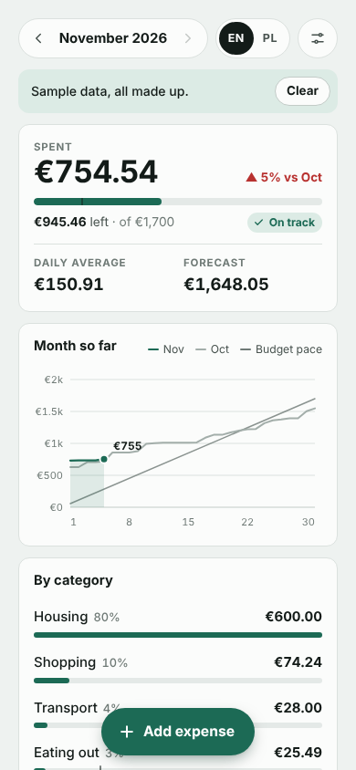
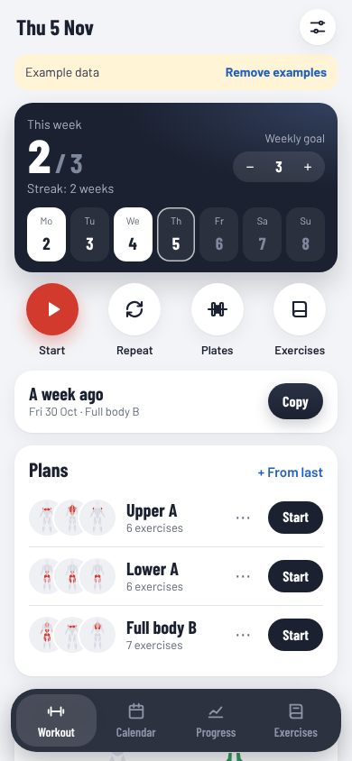
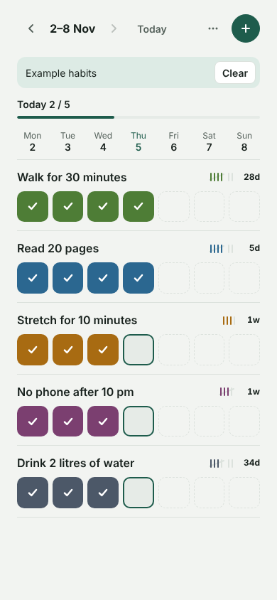
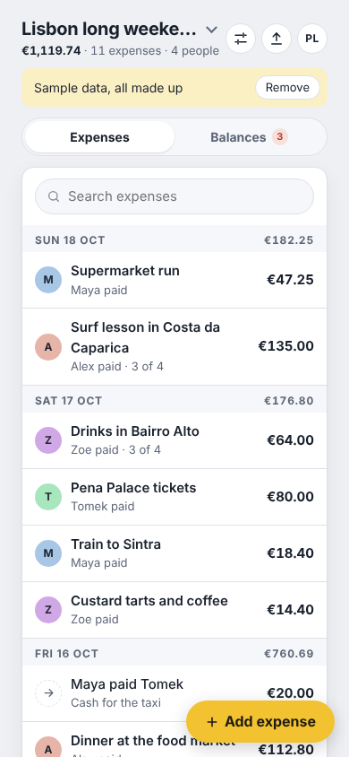

# One File Apps

Small, useful apps that each fit in **one HTML file**. Open it in any browser
or an AI chat: no install, no account, no tracking, and your data stays on
your device. English and Polish, made for phones.

## Apps

<!-- catalog:start -->
| | App | |
|---|---|---|
|  | **Expense Tracker · Monthly budget** Log personal expenses, set a monthly budget per category and see where the money went. JSON and CSV export. | [more](apps/expense-tracker/monthly-budget/README.md) |
|  | **Gym Tracker · Muscle map** Plan workouts, log sets and weights, track progress and see which muscles you trained on a body map. | [more](apps/gym-tracker/muscle-map/README.md) |
|  | **Habit Tracker · Weekly grid** Track daily or N-times-a-week habits on a week grid with tally marks, streaks and a 26-week heatmap. | [more](apps/habit-tracker/weekly-grid/README.md) |
|  | **Trip Expense Splitter · Multi-currency** Split shared trip costs between friends in several currencies and settle up with the fewest payments. | [more](apps/trip-expense-splitter/multi-currency/README.md) |
<!-- catalog:end -->

---

[How to contribute](CONTRIBUTING.md) · [Rules for building apps](ARTIFACTS-DEVELOPMENT.md) · [Security](SECURITY.md) · License: code [MIT](LICENSE), sample data [CC0](https://creativecommons.org/publicdomain/zero/1.0/)
