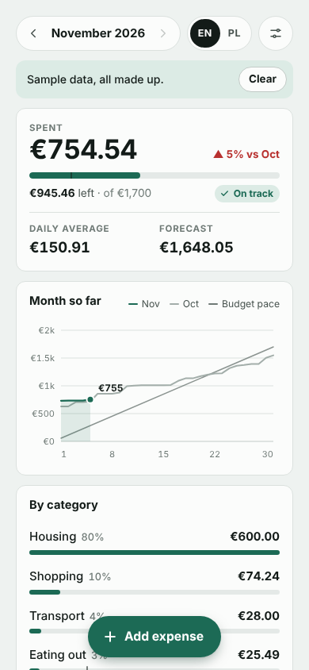
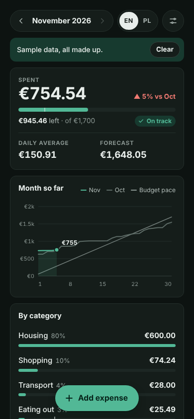
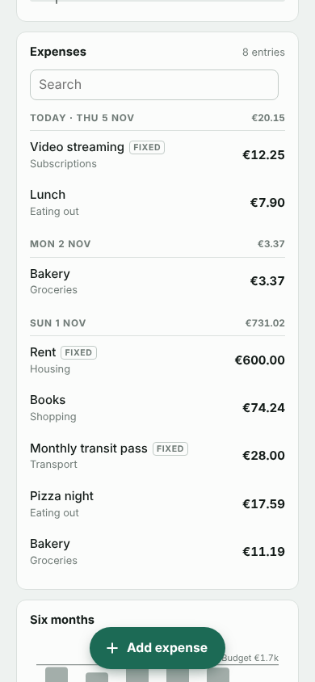

# Expense Tracker · Monthly budget

Log personal expenses, set a monthly budget per category and see where the money went. JSON and CSV export.

**PL:** **Wydatki** · Zapisuj wydatki, ustaw miesięczny budżet na kategorie i zobacz, gdzie poszły pieniądze. Eksport JSON i CSV.

  
  
  

## Features

- Add an expense in a few taps from a bottom sheet
- Monthly budget overall and per category, with pace and forecast
- Spending by category, month-over-month chart, fixed costs
- Search and filter; JSON and CSV export and import

## Use it

Download [`expense-tracker-monthly-budget.html`](expense-tracker-monthly-budget.html) and open it in any browser, or give the
file to an AI chat and ask it to show it as an artifact. English and Polish,
light and dark, works offline.

## Your data

- Stays in this browser only (local storage: `pocket-ledger:v1`). Nothing is sent anywhere.
- Export: JSON, CSV · Import: JSON, CSV. Back up now and then.
- Sample data (CC0, free to reuse): [expense-tracker-sample.json](sample-data/expense-tracker-sample.json) (About 200 made-up expenses over six months, in EUR.)

## Credits

- Authors: [@piotr-liszka](https://github.com/piotr-liszka)
- Version 1.0.0 · MIT license · [Changelog](CHANGELOG.md)
