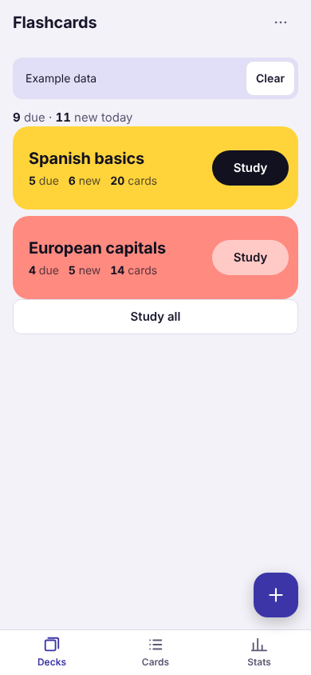
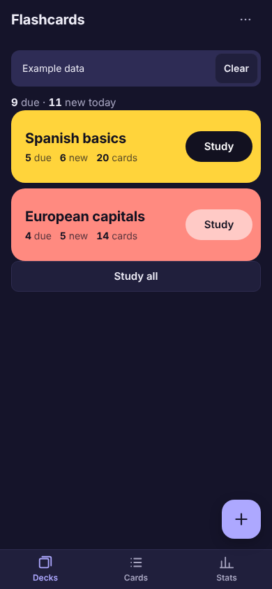
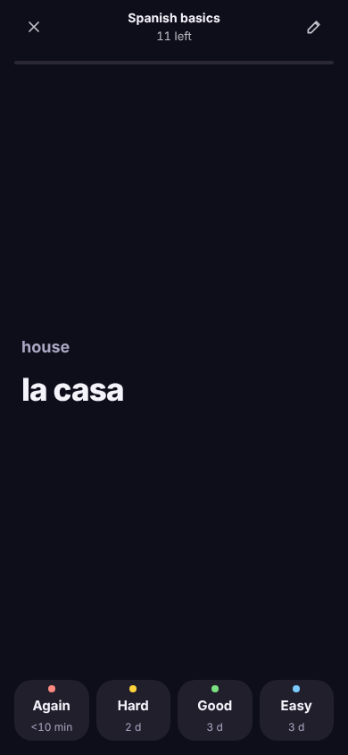
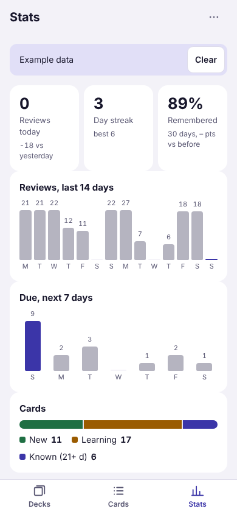

# Flashcards · Spaced repetition

Learn with flip cards in decks; each answer sets when you see the card again. Paste cards from a spreadsheet, track reviews and your streak.

**PL:** **Fiszki** · Ucz się z fiszek w taliach; każda odpowiedź ustala, kiedy karta wróci. Wklej karty z arkusza, śledź powtórki i serię dni.

  
  
  
  

## Features

- Decks of two-sided cards; tap the card to flip it
- Again, Hard, Good, Easy: each button shows when the card comes back (SM-2 style scheduling)
- A daily limit for new cards; due cards and new cards are mixed in one session
- Paste or load cards from CSV or TSV (front, back), search and edit cards
- Reviews per day, a 7-day forecast, streak and how many cards you know
- JSON backup and CSV export with Copy fallback, validated import

## Use it

Download [`flashcards-spaced-repetition.html`](flashcards-spaced-repetition.html) and open it in any browser, or give the
file to an AI chat and ask it to show it as an artifact. English and Polish,
light and dark, works offline.

## Your data

- Stays in this browser only (local storage: `flashcards-spaced-repetition:data`; unreadable data is kept aside in `flashcards-spaced-repetition:data:unreadable`). Nothing is sent anywhere.
- Export: JSON, CSV · Import: JSON, CSV. Back up now and then.
- Sample data (CC0, free to reuse): [flashcards-sample.json](sample-data/flashcards-sample.json) (Two small decks: basic Spanish words and European capitals, with some review history.)

## Credits

- Authors: [@piotr-liszka](https://github.com/piotr-liszka)
- Version 1.0.0 · MIT license · [Changelog](CHANGELOG.md)
