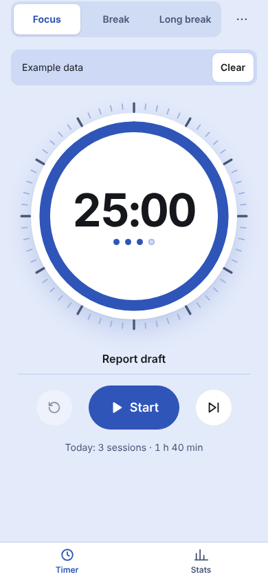
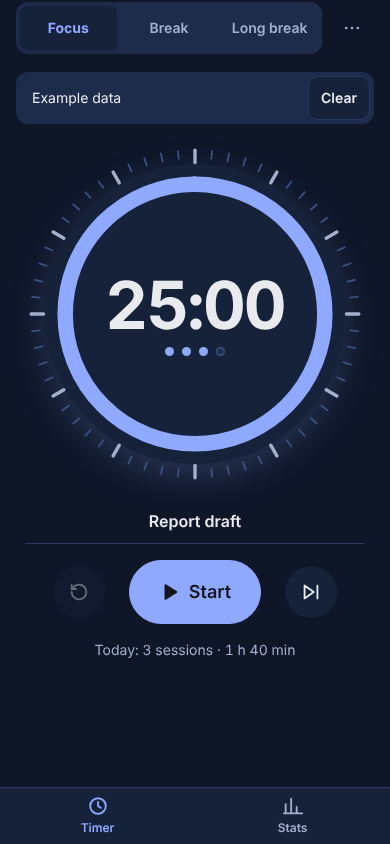
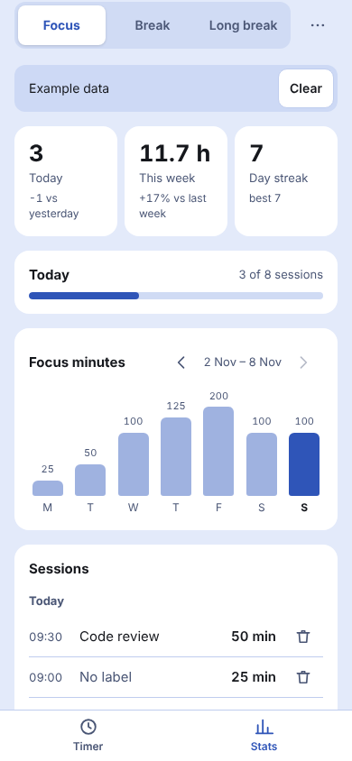

# Focus Timer · Pomodoro

Work in focus sessions with short and long breaks on a minute dial; see sessions per day, a weekly chart and your streak.

**PL:** **Timer skupienia** · Pracuj w sesjach skupienia z krótkimi i długimi przerwami na tarczy minut; zobacz sesje dnia, wykres tygodnia i serię dni.

  
  
  

## Features

- Focus, short break and long break on one minute dial; the arc shows the time left
- Long break after every N sessions, shown as dots under the clock
- Optional label per session, chime and vibration at the end, auto-start option
- Keeps running after a reload or when the tab sleeps; the time shows in the tab title
- Today's goal, weekly focus-minutes chart, day streak and a session log
- JSON backup and CSV export with Copy fallback, validated import

## Use it

Download [`focus-timer-pomodoro.html`](focus-timer-pomodoro.html) and open it in any browser, or give the
file to an AI chat and ask it to show it as an artifact. English and Polish,
light and dark, works offline.

## Your data

- Stays in this browser only (local storage: `focus-timer-pomodoro:data`; unreadable data is kept aside in `focus-timer-pomodoro:data:unreadable`). Nothing is sent anywhere.
- Export: JSON, CSV · Import: JSON. Back up now and then.
- Sample data (CC0, free to reuse): [focus-timer-sample.json](sample-data/focus-timer-sample.json) (About three weeks of made-up focus sessions with short labels.)

## Credits

- Authors: [@piotr-liszka](https://github.com/piotr-liszka)
- Version 1.0.0 · MIT license · [Changelog](CHANGELOG.md)
