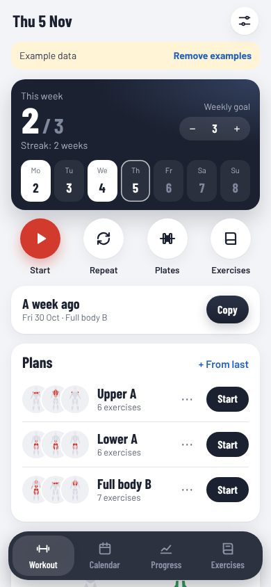
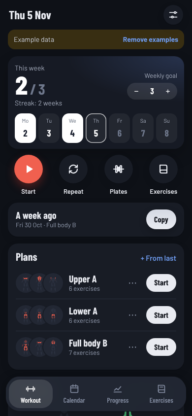
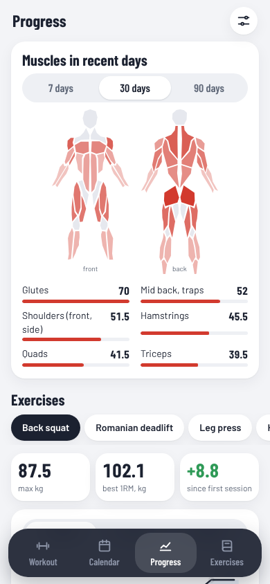

# Gym Tracker · Muscle map

Plan workouts, log sets and weights, track progress and see which muscles you trained on a body map.

**PL:** **Dziennik treningowy** · Planuj treningi, zapisuj serie i ciężary, śledź postępy i zobacz na mapie ciała, które mięśnie pracowały.

  
  
  

## Features

- Workout plans, quick start or repeat the last session
- Log sets, reps and weight with suggestions from last time
- Rest timer with sound and vibration, screen stays on
- Progress charts, estimated 1RM, calendar
- Muscle map of what you trained, kg or lb, plate calculator

## Use it

Download [`gym-tracker-muscle-map.html`](gym-tracker-muscle-map.html) and open it in any browser, or give the
file to an AI chat and ask it to show it as an artifact. English and Polish,
light and dark, works offline.

## Your data

- Stays in this browser only (local storage: `gym-notebook.v1`). Nothing is sent anywhere.
- Export: JSON · Import: JSON. Back up now and then.
- Sample data (CC0, free to reuse): [gym-tracker-sample.json](sample-data/gym-tracker-sample.json) (Three made-up workout plans and about eight weeks of logged sessions.)

## Credits

- Authors: [@piotr-liszka](https://github.com/piotr-liszka)
- Version 1.0.0 · MIT license · [Changelog](CHANGELOG.md)
- Barlow and Barlow Condensed (OFL-1.1): Font subset embedded as base64. <https://github.com/jpt/barlow>
- react-body-highlighter (MIT): Muscle map polygon shapes (src/body.json). <https://github.com/giavinh79/react-body-highlighter>
