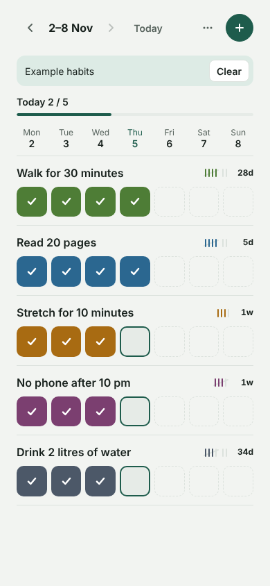
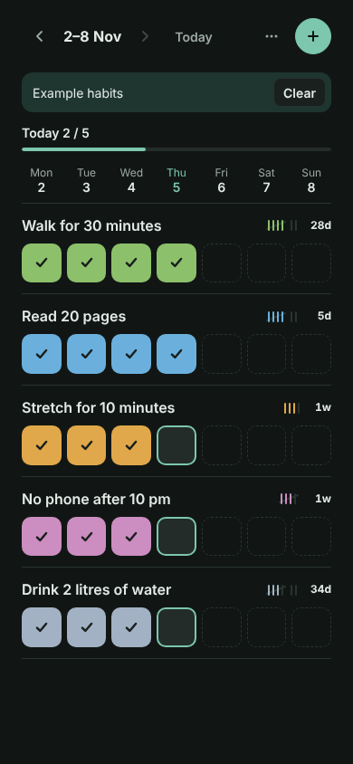
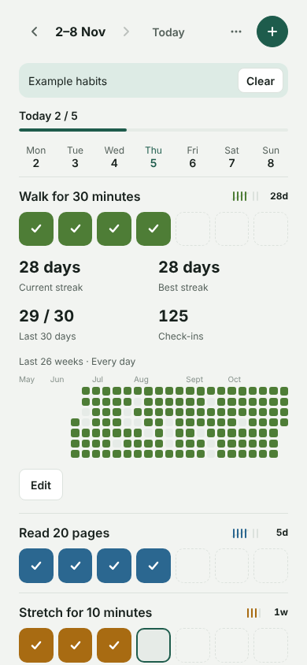

# Habit Tracker · Weekly grid

Track daily or N-times-a-week habits on a week grid with tally marks, streaks and a 26-week heatmap.

**PL:** **Tracker nawyków** · Śledź nawyki codzienne lub N razy w tygodniu: siatka tygodnia, kreski, serie i mapa 26 tygodni.

  
  
  

## Features

- Daily habits or a weekly target (1-7 times a week), shown as tally marks
- One week at a glance: tap a day to check it off
- Streaks, last-30-days score and a 26-week heatmap per habit
- JSON backup with Copy fallback, validated import

## Use it

Download [`habit-tracker-weekly-grid.html`](habit-tracker-weekly-grid.html) and open it in any browser, or give the
file to an AI chat and ask it to show it as an artifact. English and Polish,
light and dark, works offline.

## Your data

- Stays in this browser only (local storage: `tally-habits-v1`). Nothing is sent anywhere.
- Export: JSON · Import: JSON. Back up now and then.
- Sample data (CC0, free to reuse): [habit-tracker-sample.json](sample-data/habit-tracker-sample.json) (Five made-up habits with about six months of check-ins.)

## Credits

- Authors: [@piotr-liszka](https://github.com/piotr-liszka)
- Version 1.0.0 · MIT license · [Changelog](CHANGELOG.md)
