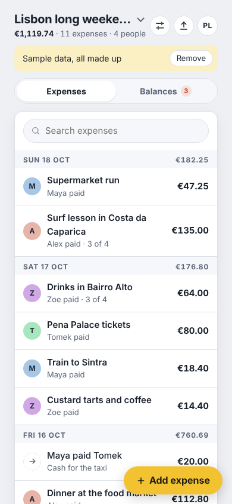
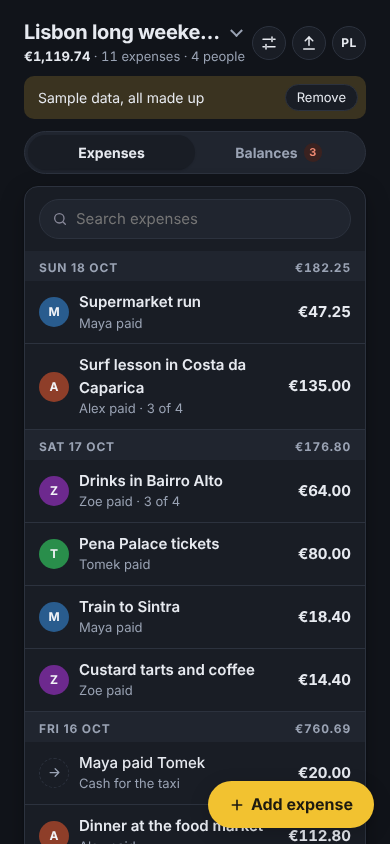
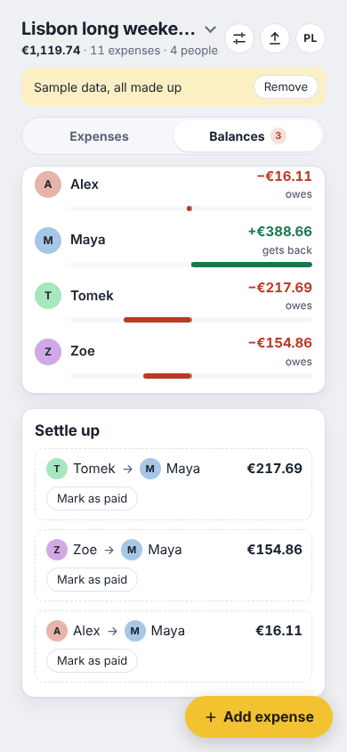

# Trip Expense Splitter · Multi-currency

Split shared trip costs between friends in several currencies and settle up with the fewest payments.

**PL:** **Podział kosztów wyjazdu** · Dziel wspólne koszty wyjazdu w kilku walutach i rozlicz się najmniejszą liczbą przelewów.

  
  
  

## Features

- Several trips, any number of people
- Expenses in different currencies with your own exchange rate
- Split equally, by exact amounts or by shares
- Balances and the fewest payments to settle up, mark as paid
- JSON export and import to share a trip with friends

## Use it

Download [`trip-expense-splitter-multi-currency.html`](trip-expense-splitter-multi-currency.html) and open it in any browser, or give the
file to an AI chat and ask it to show it as an artifact. English and Polish,
light and dark, works offline.

## Your data

- Stays in this browser only (local storage: `split-the-trip.v1`, `split-the-trip.lang`). Nothing is sent anywhere.
- Export: JSON · Import: JSON. Back up now and then.
- Sample data (CC0, free to reuse): [trip-expense-splitter-sample.json](sample-data/trip-expense-splitter-sample.json) (A made-up long weekend trip of four friends.)

## Credits

- Authors: [@piotr-liszka](https://github.com/piotr-liszka)
- Version 1.0.0 · MIT license · [Changelog](CHANGELOG.md)
